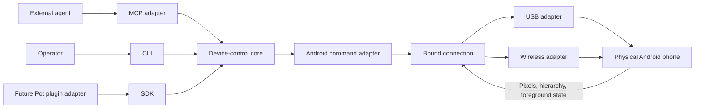

# Architecture

Implemented architecture as of 2026-10-09. The approved model-visible interface is [MCP contract](mcp-contract.md); [Qualification](qualification.md) records actual coverage. Pot integration and AccessibilityService below remain proposals.

## Objective and scope

An agent opens an installed application, navigates its UI, enters supported text, observes results and reports evidence. The phone remains a user's real device with existing accounts and data. Neither USB nor wireless access provides Sandbox isolation.

The first increment supports USB and Android wireless debugging through official ADB, with UIAutomator hierarchy dumps. Screenshots provide visual context and cover custom views absent from the hierarchy. A dedicated InputMethodService companion supplies Unicode text input in MVP; its provisioning remains an operator workflow. Optional scrcpy lets the operator watch and take over. A Kotlin AccessibilityService companion is a later option for semantic actions, richer input and page-change events.

The approved MVP scope covers installed-app discovery, launch/switch and explicit stop; click, long press, swipe/drag; dedicated-IME Unicode input with declared insertion/replacement semantics; and Back/Home/Recents. Concrete methods and arguments are approved and implemented in the MCP contract. Multi-touch, root, legacy unauthenticated TCP setup, emulator provisioning, APK installation and unrestricted phone shell access are outside the initial agent surface. Browser use means operating the installed browser's visible Android UI; DOM/CDP browser attachment is deferred.

## Components

| Module | Responsibility |
| --- | --- |
| Core | Session identity, exclusive device ownership, observation revisions, action admission, settling, cancellation and outcome classification |
| Connection layer | USB/wireless inventory, configured device selection, endpoint binding, connection generation and disconnect handling |
| ADB adapter | Commands through an exact bound connection, PNG capture, hierarchy acquisition and foreground/geometry probes |
| MCP adapter | Runtime documentation, model-visible calls, typed images, bounded structured feedback and connection cleanup |
| SDK | Typed access to the same core without an agent transport |
| CLI | Installation diagnostics, device selection and operator inspection; JSON output for automation |

Use TypeScript on Node.js, the official MCP TypeScript SDK, Zod for boundary validation and a maintained XML parser with DTD/external-entity resolution disabled. Use argument-array process APIs instead of host shell command strings. Android shell interpretation still requires separate validation and escaping: host argv safety alone is insufficient for text input.

## Integration boundaries

Android Use runs on the host connected to the phone over USB or an explicitly configured wireless endpoint. It does not forward device control into a Pot guest or treat a physical phone as an existing VM provider. Pot remains responsible for its owner authorization, task assignment and persistence; the component enforces its configured device capabilities below SDK, CLI and MCP entry points.

Keep `plugins/computer-use/` focused on its browser responsibility. A future `plugins/android-use/` adapter requires an agreed tool interface and a packaging/Host-execution design. Pot's current plugin bundles have file/size limits, scalar tool schemas and no Host-only manifest mode, so this TypeScript project cannot simply be registered as a built-in plugin without reviewing those constraints. That integration is a separate milestone.

## Device and session ownership

Enumerate devices without claiming them. Opening requires an explicit device selection and connection kind; no default-to-first-device or implicit fallback between USB and wireless. USB requires a data cable and phone-side debugging authorization; wireless requires operator pairing and an explicit enrolled endpoint. See [Connections](connections.md) for binding and setup. Report unauthorized/offline devices without accepting phone-side authorization prompts.

Bind each session to enrolled device identity, connection kind, current ADB selector, transport identity, connection generation and fixed capabilities. Reconnection requires explicit rebinding and a fresh observation even when serial is unchanged. Serial is a routing identifier, not authentication or sufficient device identity by itself.

One enrolled device has one controller lease across Android Use processes and connection kinds on the host. Use a shared host-local lease/lock mechanism, with explicit stale-owner reconciliation, so SDK and multiple MCP instances cannot each acquire an independent in-memory lock. Serialize observations and actions within the lease. This cannot exclude Android Studio, arbitrary ADB clients or human input; detect visible changes where possible and document the remaining race.

Close releases the lease and pending host processes; it does not force-stop the user's app, reset the phone, delete data or undo actions. Do not call global `adb kill-server`. Cancellation terminates owned command processes and stops further dispatch; already injected phone input may still take effect.

## State, limits and diagnostics

Use bounded command timeouts, hierarchy size/node limits and screenshot limits. Defaults are published in the MCP contract; observations distinguish partial capture and limitations. Temporary hierarchy files use per-session paths and are cleaned up; stdout carries protocol content and stderr carries diagnostics.

Keep raw screenshots, hierarchy, URLs and typed text out of default durable diagnostics. Retain minimal request IDs, outcome states and device-generation metadata for recovery. Explicit test artifacts may include observations, with operator-selected storage and retention. Machine-specific connection and setup notes belong in `~/Workspace/Machines`, not this component.

Protected screens can produce black screenshots or inaccessible fields; return the limitation and do not claim bypass capability. Lock screen, permission dialogs, keyboard overlays and OEM differences are explicit qualification cases.
